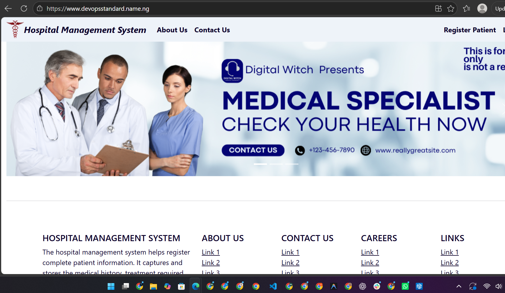
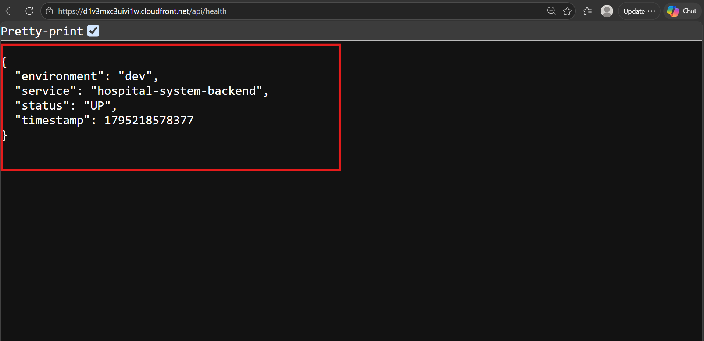
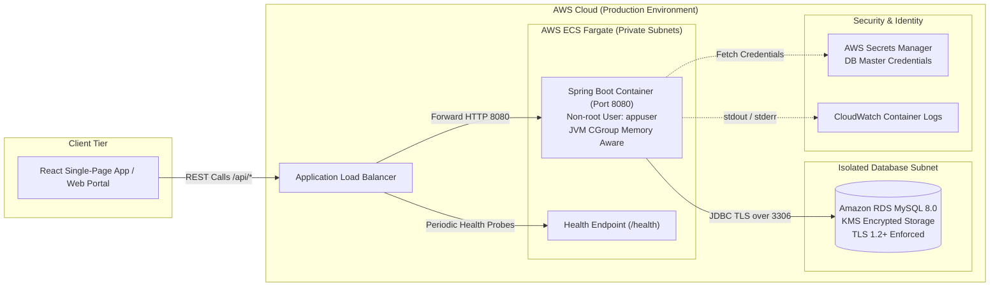

# 🏥 Hospital Management System - Backend API (Spring Boot & AWS ECS Fargate)

> **Enterprise-grade RESTful API** for the hospital management platform, built with Spring Boot, packaged as a security-hardened container, and orchestrated on AWS ECS Fargate.

---

## 🔗 Hospital System Ecosystem

This repository is the backend API engine of the decoupled three-tier hospital system:

| Repository | Tech Stack | Role |
| :--- | :--- | :--- |
| [🏗️ `hospital-system-infra`](https://github.com/Dubemphil/hospital-system-infra) | Terraform, AWS (VPC, ECS, RDS, CloudFront, KMS, OIDC) | Core Cloud Infrastructure & Security Foundation |
| [☕ `hospital-system-backend`](https://github.com/Dubemphil/hospital-system-backend) | Spring Boot (Java), MySQL, Docker, Maven | RESTful Healthcare API & Business Logic |
| [⚛️ `hospital-system-frontend`](https://github.com/Dubemphil/hospital-system-frontend) | React 18, HTML5/CSS3, Single-Page App | Patient & Staff Interactive Web Portal |

* **Live Web Portal**: [https://www.devopsstandard.name.ng](https://www.devopsstandard.name.ng)

* **Live Direct CDN**: [https://d1v3mxc3uivi1w.cloudfront.net](https://d1v3mxc3uivi1w.cloudfront.net)
* **Backend API Health Check**: [https://d1v3mxc3uivi1w.cloudfront.net/api/health](https://d1v3mxc3uivi1w.cloudfront.net/api/health)

---

## 🏛️ Architecture & Runtime Overview

  

---

## 📋 REST API Endpoints Reference

### 1. Health & Diagnostics (ALB & Container Probes)
* `GET /health` or `GET /api/health` - Lightweight liveness/readiness probe returning `{"status": "UP"}`.

### 2. User & Authentication
* `POST /api/user/register` - Register patient, doctor, or staff accounts.
* `POST /api/user/login` - Authenticate users and return JWT Bearer token.
* `GET /api/user/roles` - Retrieve list of authorization roles.
* `GET /api/user/gender` - Retrieve supported demographic options.
* `GET /api/user/id?userId={id}` - Fetch user profile metadata.

### 3. Appointments & Scheduling
* `POST /api/appointment/patient/add` - Book a new clinical appointment.
* `GET /api/appointment/all` - List appointments (admin / clinical staff).
* `GET /api/appointment/patient/id?patientId={id}` - Retrieve patient appointment history.
* `GET /api/appointment/doctor/id?doctorId={id}` - Retrieve doctor's scheduled consultations.
* `POST /api/appointment/admin/assign/doctor` - Assign consulting physician to an appointment.
* `POST /api/appointment/doctor/update` - Doctor updates appointment notes and status.

### 4. Doctors & Medical Specialists
* `GET /api/doctor/all` - Directory of registered healthcare practitioners.
* `GET /api/doctor/specialist/all` - Filter practitioners by medical specialization.
* `POST /api/doctor/register` - Onboard practitioner profile.

### 5. Patient Records
* `GET /api/patient/all` - List all registered patients.
* `GET /api/patient/bloodgroup/all` - Directory of blood group classifications.

---

## 🛡️ Enterprise Security & CI/CD Pipeline

The GitHub Actions workflow (`.github/workflows/backend-ci-cd.yml`) automates comprehensive security validation and automated deployment:

1. **Secret Leak Detection**: Pre-build scanning via **Gitleaks** prevents credentials from reaching the repository.
2. **Dockerfile Linting**: Pre-build inspection via **Hadolint** ensures container best practices (least-privilege, clean caching).
3. **Dependency Vulnerability Scanning**: File system and Maven dependency scanning via **Aqua Security Trivy**.
4. **Keyless AWS OIDC Authentication**: Workflows authenticate to AWS STS using temporary OpenID Connect (OIDC) tokens—**zero static access keys in GitHub**.
5. **Secure Container Registry**: Image pushed to **Amazon ECR** with automated scan-on-push and SHA-pinned image tags.
6. **Rolling Zero-Downtime Deployment**: Updates the **AWS ECS Fargate** service with automated deployment circuit breakers and rollback protection.

---